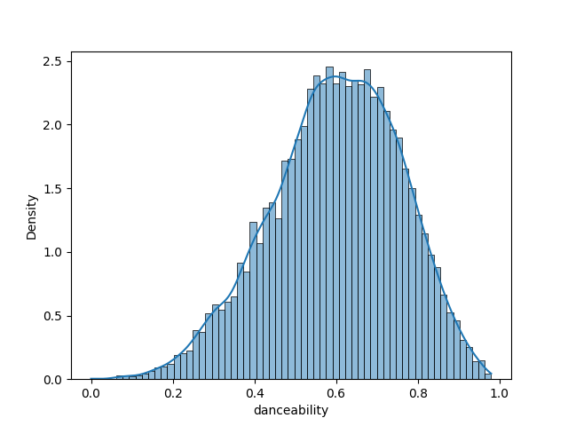
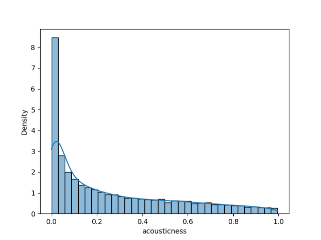
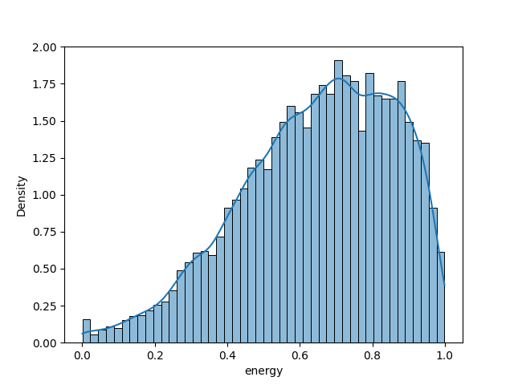
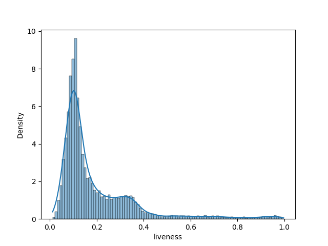
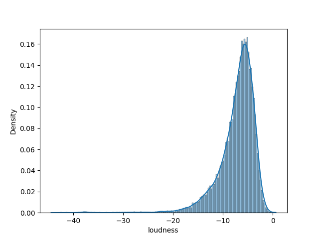
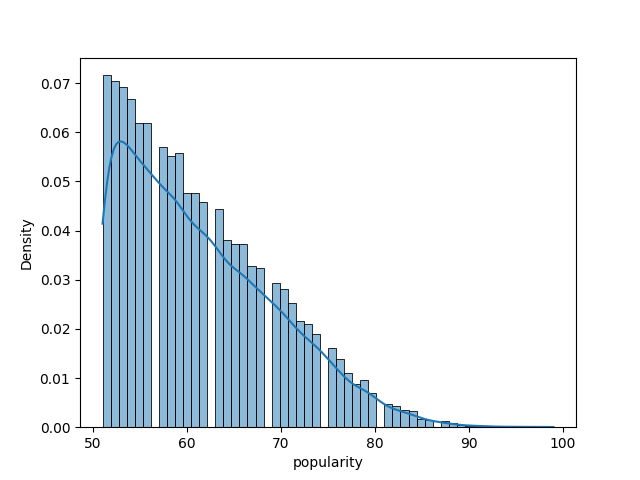
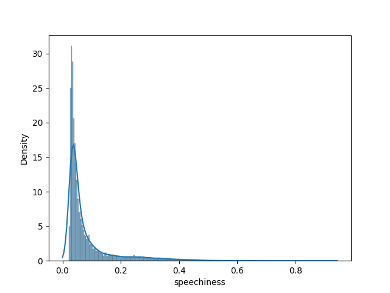
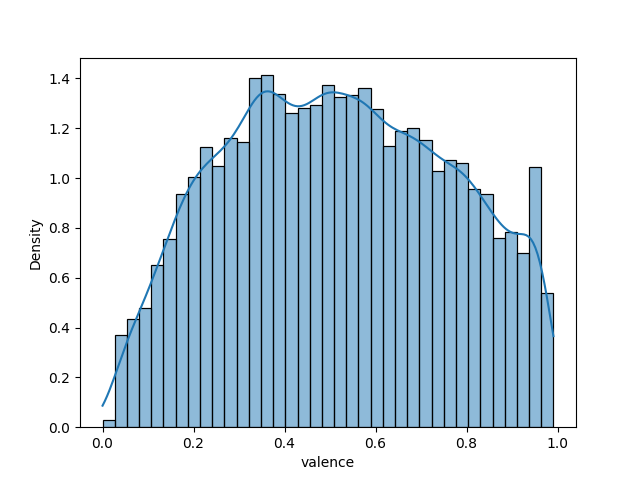
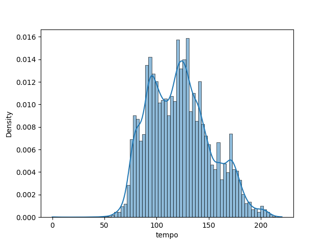
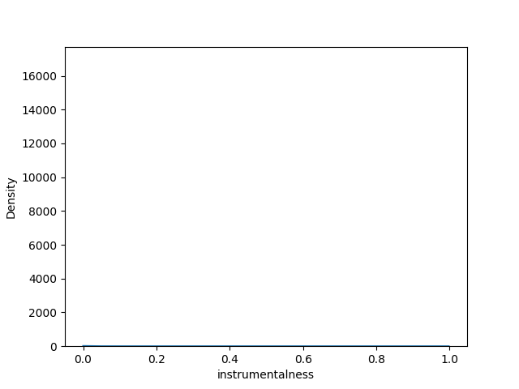

# Definicja problemu biznsesowego

Chcemy stworzyć model, który będzie tworzył playlisty z pasującymi do siebie utworami.

1. Tworzenie playslit na podstawie najpopularniejszych piosenek z danego gatunku pasujące do siebie współczynnikami takimi jak dancebility, energy, loudness, speechiness itp
2. Tworzenie playlist z w danej kategorii. Dalej piosenki powinny być wybierane ze względu na popularnosć i datę wydania.
   1. piosenki do tańczenia - duże dancebility i acousticness
   2. piosenki na imprezę - duże dancebility, energy i liveness
   3. piosenki do relaksu - duze acousticness, intrementality oraz wolne tempo
3. Tworzenie playlist ze względu na datę wydania

## Analiza danych

